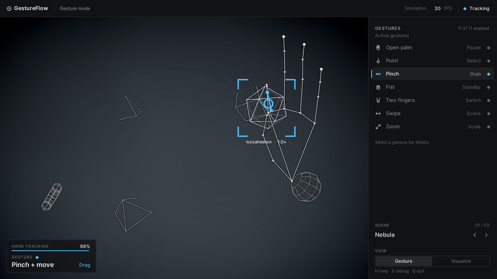
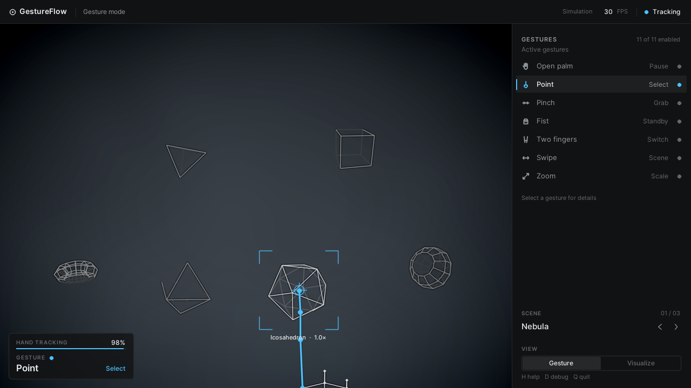
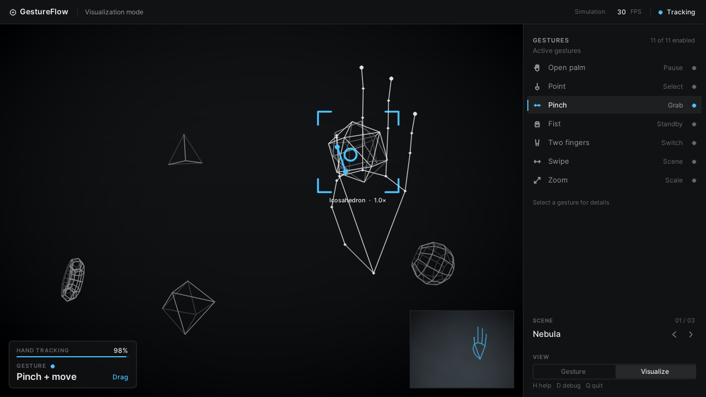
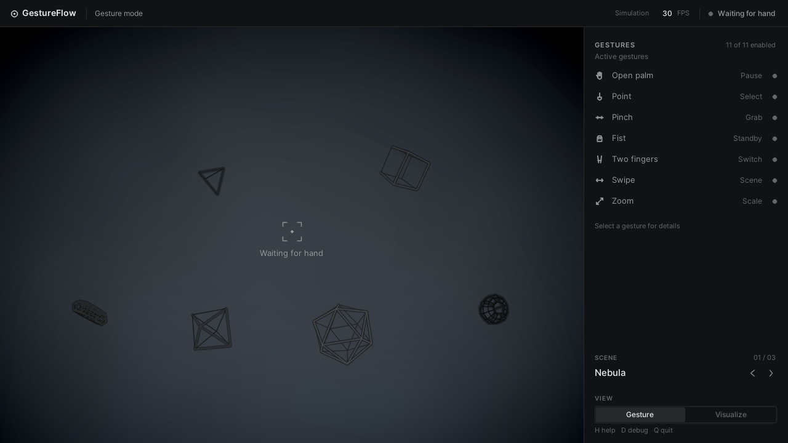
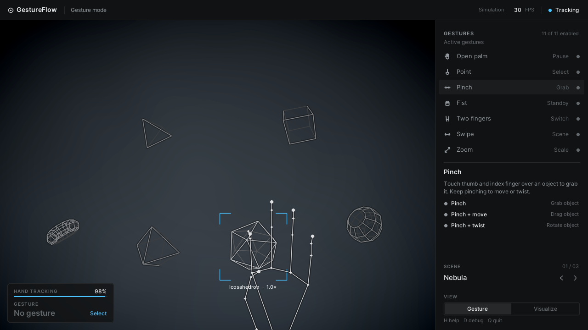
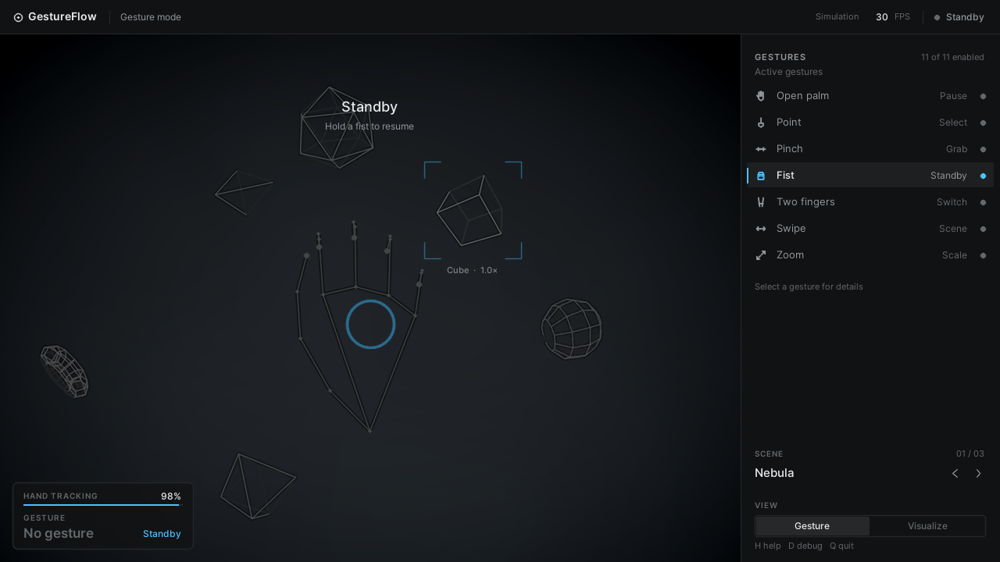
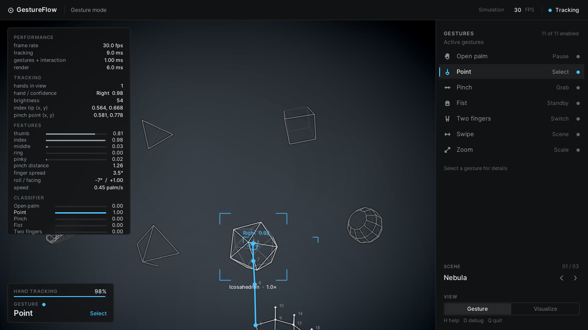
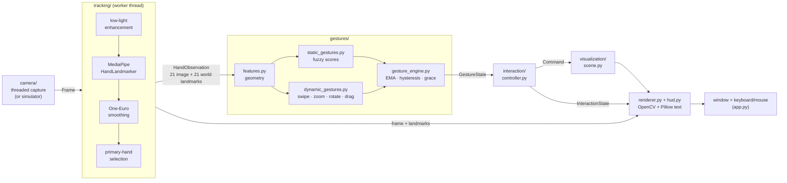

# GestureFlow

**A real-time, webcam-based hand-gesture interface.** Point, pinch, drag, twist, swipe, spread and
make a fist to control an interactive 3D-looking environment — with nothing but your hand and a
normal webcam. Built on **MediaPipe** (hand landmarks) and **OpenCV** (capture, image processing,
rendering); everything runs locally, no cloud APIs.



> The screenshots in this README are rendered by GestureFlow's built-in **simulation mode**
> (`python app.py --simulate`): a scripted *synthetic* hand drives the real pipeline, so you can
> try the whole application — and so the project can be tested — without a webcam.

---

## Contents

1. [Overview](#1-overview)
2. [Demo](#2-demo)
3. [Architecture](#3-architecture)
4. [Installation](#4-installation)
5. [Running](#5-running)
6. [Gestures](#6-gestures)
7. [The computer-vision pipeline](#7-the-computer-vision-pipeline)
8. [Feature extraction](#8-feature-extraction)
9. [Static vs. dynamic gesture recognition](#9-static-vs-dynamic-gesture-recognition)
10. [Performance](#10-performance)
11. [Troubleshooting](#11-troubleshooting)
12. [Future improvements](#12-future-improvements)
- [Optional: learned classifier](#optional-learned-classifier) · [Testing](#testing) · [Configuration](#configuration) · [Known limitations](#known-limitations)

---

## 1. Overview

GestureFlow turns a webcam into a touchless pointing device. The interesting part is not
"MediaPipe found a hand" — it is everything between the 21 landmarks and a feeling of control:

* **Geometry, not magic numbers in the UI.** Landmarks become scale-, rotation- and
  position-invariant *features* (finger extension, pinch distance, finger fan-out, palm normal, wrist
  roll, palm-relative velocity). Gestures are decided from features, never from raw pixels.
* **Soft classification + temporal smoothing.** Every static gesture gets a fuzzy score in [0, 1];
  scores are averaged over time, gated by hysteresis and a confirm time, so the label does not flicker.
* **Real multi-frame gestures.** Swipes, zoom, drag and rotate come from a short history of
  positions, rolls and finger spacing — not from a single frame.
* **A clean command layer.** Gestures never touch the scene directly: a controller turns gesture
  state into small `Command` objects. That makes the logic unit-testable and the scene reusable.
* **Engineered for reliability.** No hand, two hands, a hand leaving the frame, low light, noisy
  landmarks and a missing/failing camera are all handled (and tested).

The project also ships an optional **learned classifier** (record → train → plug in) and a
**simulation mode** that doubles as the end-to-end regression test.

## 2. Demo

The default scene (**NEBULA**) holds six floating wireframe solids. Two more scenes (**AURORA**,
**EMBER**) are one swipe away. With your hand in view:

1. **Point** at an object — a small reticle's ring fills and the object is *selected* (thin corner brackets).
2. **Pinch** (thumb + index) to *grab* it, **move** your hand to drag it, let go to *throw* it.
3. **Twist** your wrist while pinching to *rotate* it.
4. **Spread / close your fingers** to *zoom* it (or the whole scene if nothing is selected).
5. Raise **two fingers** and move up/down to *switch* between objects.
6. **Swipe** left/right to change scene (animated transition).
7. **Open palm** pauses the scene; hold it still for 2 s to *reset*. **Hold a fist** to toggle
   standby (gestures ignored) — and again to wake up.

| Gesture mode (camera feed + overlay) | Visualization mode (immersive, camera in a corner) |
|---|---|
|  |  |

### Interface design

The interface is deliberately quiet: the **hand and the scene are the product**, everything else
supports them.

| Priority | What | Where |
|---|---|---|
| 1 | Your hand and the scene | the canvas — ~74 % of the window, camera cropped to *cover* it (no bars) |
| 2 | Current gesture | a compact translucent readout, bottom-left of the canvas |
| 3 | Tracking state | a status dot in the slim top bar (+ one confidence line in the readout) |
| 4 | Selected object | thin corner brackets and a one-line label next to the object |
| 5 | Controls | the side panel (~26 %, collapses on narrow windows) |
| 6 | Debug information | hidden until `D` |

* **Restraint.** Neutral near-black surfaces, one accent colour (electric blue) that only ever
  means *state*: tracking, the active gesture, the selection. Hairlines instead of boxes, 3–6 px
  corner radii, no glows, no particles, no pulsing.
* **The CV is visible, not decorative.** The skeleton is thin lines and small joints; only the
  landmarks that *define the current gesture* turn accent-coloured — thumb + index and the
  connection between them for a pinch, the index finger for a point, the fingertips for an open
  hand — so you can see what the classifier is looking at.
* **Short, small feedback.** A precise reticle with a dwell ring for pointing; a ring at the pinch
  point; a thin arc with an arrowhead while rotating; chevrons for a swipe; thin progress rings for
  hold-to-act. Each lasts a fraction of a second.
* **Tool-style side panel.** Seven rows (related gestures are grouped — *Pinch* covers pinch, drag
  and rotate), each with an icon, a name, a one-word effect and a status dot. Click a dot to switch
  a family on/off; click a row to open its details (how to perform it, and per-gesture switches).
  A segmented control switches mode and a small selector steps through scenes.
* **Typography.** Inter (bundled, SIL OFL) rendered with Pillow, in four sizes with weight — not
  size or colour — carrying the hierarchy.
* **Responsive.** The layout is computed from the live window size (and UI scale from the same),
  the render resolution follows the window, and the camera→cursor mapping is recomputed whenever the
  canvas changes shape. Try `--window 800x520`, or resize / maximise the window.

| Waiting for a hand | Row details | Standby |
|---|---|---|
|  |  |  |

Press `H` for the in-app help and `D` for the debug overlay (frame rate and per-stage timings,
tracking confidence, landmark coordinates, finger-extension bars, classifier scores, landmark
indices):



## 3. Architecture



Data flows one way through small, typed hand-offs:

`Frame → HandObservation → HandFeatures → GestureState → Command → Scene → pixels`

```
gestureflow/
├── app.py                  CLI, wiring, main loop, keyboard/mouse
├── config.py               every tunable number (frozen dataclasses, no globals)
├── camera/
│   ├── capture.py          threaded webcam capture, latest-frame semantics, reconnect
│   └── simulated.py        fake camera for --simulate / tests
├── tracking/
│   ├── hand_tracker.py     MediaPipe wrapper, model download, primary-hand selection, low light
│   ├── filters.py          One-Euro filter
│   ├── pipeline.py         camera→tracker on a worker thread (frame + result stay paired)
│   ├── types.py            HandObservation, TrackingResult, landmark constants
│   ├── synthetic.py        parametric hand model (tests, simulation, training data)
│   └── simulated.py        scripted demo hand = a Tracker without a camera
├── gestures/
│   ├── features.py         normalisation + geometric features
│   ├── static_gestures.py  rule-based fuzzy classifier
│   ├── dynamic_gestures.py multi-frame recognisers
│   ├── gesture_engine.py   smoothing / hysteresis / dropout handling → GestureState
│   ├── learned_classifier.py  optional scikit-learn classifier + hybrid
│   └── types.py            Gesture enum, GestureState, UI metadata
├── interaction/
│   ├── controller.py       GestureState → Commands, interaction state machine
│   ├── commands.py         the Command vocabulary
│   └── mapping.py          camera ↔ scene coordinates
├── visualization/
│   ├── scene.py            objects, physics, scene switching (pure state, no effects)
│   ├── renderer.py         responsive layout, camera cover-crop, objects, hand skeleton, feedback cues
│   ├── hud.py              top bar, readout, side panel, help, debug overlay; Layout
│   ├── theme.py            design tokens (one accent, neutral surfaces, radii)
│   ├── typeface.py icons.py draw.py     Pillow text (Inter), vector icons, primitives
│   ├── shapes.py ui_state.py            meshes; UI state and the gesture-family grouping
├── assets/fonts/           Inter (SIL Open Font License)
├── learning/               dataset format, recorder, trainer, synthetic-data generator
├── tools/                  download_model.py, make_screenshots.py
└── tests/                  340 tests, none need a webcam
```

Design rules that keep it clean: computer-vision code never imports rendering code; the scene never
imports gestures (it only understands `Command`s); the renderer only *reads* state; time always
comes from frame timestamps (never `time.time()` inside logic), which makes everything deterministic
to test.

## 4. Installation

Requires **Python 3.10+** and a webcam (or use `--simulate`). Developed and tested on Python 3.10.12,
MediaPipe 1.0.1, OpenCV 5.0, NumPy 2.2 on Windows 11. The code itself is platform-neutral (only the
camera-backend choice differs per OS).

**Windows (PowerShell)**
```powershell
cd gestureflow
py -3.11 -m venv .venv          # any Python 3.10+
.\.venv\Scripts\Activate.ps1
pip install -r requirements.txt
```

**macOS**
```bash
cd gestureflow
python3 -m venv .venv && source .venv/bin/activate
pip install -r requirements.txt
```
The first run asks for camera permission for your terminal app (System Settings → Privacy & Security → Camera).

**Linux**
```bash
cd gestureflow
python3 -m venv .venv && source .venv/bin/activate
pip install -r requirements.txt
# if OpenCV complains about libGL on a minimal install:  sudo apt install libgl1
# camera permission:  sudo usermod -aG video $USER   (then log out / in)
```

The 7.8 MB MediaPipe hand model is downloaded **once** on first run to `models/`
(inference is fully local). To fetch it ahead of time / for offline machines:
`python tools/download_model.py`, or save
[hand_landmarker.task](https://storage.googleapis.com/mediapipe-models/hand_landmarker/hand_landmarker/float16/1/hand_landmarker.task)
as `models/hand_landmarker.task`.

Optional extras: `pip install -r requirements-learning.txt` (learned classifier),
`pip install -r requirements-dev.txt` (tests + linter).

## 5. Running

```bash
python app.py                      # webcam
python app.py --simulate           # scripted synthetic hand — no webcam needed
python app.py --list-cameras       # which camera indices work
python app.py --camera 1 --width 1280 --height 720   # camera size
python app.py --window 1600x900                        # initial window size (it is resizable)
python app.py --max-hands 2 --hand Right   # track both hands; the right one controls
python app.py --mode visualization --debug
python app.py --help               # everything
```

Run all commands from the project folder (the packages are top-level: `camera`, `tracking`, …).

| Key | Action | | Key | Action |
|---|---|---|---|---|
| `Q` / `Esc` | quit | | `1` | gesture mode |
| `R` | reset scene | | `2` | visualization mode |
| `H` | toggle help | | `D` | toggle debug landmarks |
| `G` | toggle side panel | | `N` / `P` | next / previous scene |
| `Tab` | next object | | `S` | save screenshot (`screenshots/`) |
| `M` | one ↔ two-hand tracking | | `F` | fullscreen |

**Mouse:** in the side panel, click a gesture's status dot to switch that family on/off, click its row to
open details (and per-gesture switches), use the *Gesture / Visualize* control to change mode and the
‹ › arrows to change scene.

**Modes.** *Gesture mode* shows the live camera feed (the active region of it) with the scene
overlaid — best for learning the gestures. *Visualization mode* is an immersive dark scene with the
camera as a picture-in-picture and a faint holographic hand.

**Headless / CI:** `python app.py --simulate --headless --max-frames 300 --save-frame out.png`
prints a per-stage timing summary and saves the last composed frame. `python tools/make_screenshots.py`
regenerates the README images.

## 6. Gestures

| Gesture | How to perform it | Type | Result |
|---|---|---|---|
| **Open palm** | all fingers extended | static | **Pause** (scene slows to a near-freeze). Hold *steady* for 2 s → **reset** the scene (ring shows progress) |
| **Point** | index extended, others curled | static | Move the cursor; **dwell 0.3 s on an object to select it**; dwell on empty space for 1 s to deselect |
| **Pinch** | thumb tip touches index tip | static | **Grab** the object under the pinch (one grab per pinch; a pinch on empty space shows a "miss" ring) |
| **Pinch + move** | keep pinching and move | dynamic | **Drag** — the object follows with the offset you grabbed it at; release while moving to **throw** it |
| **Pinch + twist** | keep pinching and rotate your wrist (in the image plane) | dynamic | **Rotate** the grabbed object (it holds still while rotating) |
| **Fist** | all fingers curled; **hold ~0.5 s** | static | Toggle **standby ⇄ active** (ring shows progress; ignored right after a pinch so releasing with a fist is safe) |
| **Two fingers** | index + middle extended, others curled; move up/down | static + motion | **Scroll** / switch the selected object (up = next, down = previous) |
| **Swipe left / right** | fast, straight, mostly horizontal hand sweep with an open hand | dynamic | **Next / previous scene** (the "return stroke" of a swipe is ignored) |
| **Spread fingers** | open hand, fan the fingers out | dynamic | **Zoom in** the grabbed/selected object (or the whole scene) |
| **Fingers together** | open hand, bring the fingers together | dynamic | **Zoom out** |

Each gesture family can be switched off in the side panel; the readout on the canvas shows the
current gesture and its command.

## 7. The computer-vision pipeline

1. **Capture** (`camera/capture.py`). A background thread reads the webcam continuously and keeps
   only the *newest* frame, so a slow consumer never works through a backlog (low latency beats
   completeness). Frames are mirrored (selfie view) so moving right in reality is moving right on
   screen. On Windows the Media Foundation backend is preferred (DirectShow capped this webcam at
   ~16 FPS), with fallbacks.
2. **Low-light handling** (`tracking/hand_tracker.py`). Mean luma is estimated from a sub-sampled
   frame. If it is below a threshold, a **gamma lookup table** — solved from
   `(luma/255)^γ = target/255` and clamped so noise is not over-amplified — brightens the frame *for
   detection only*, and the HUD shows a "low light" notice.
3. **Hand landmarks.** MediaPipe's `HandLandmarker` (palm detector + 21-point landmark model, VIDEO
   mode) returns, per hand, **image landmarks** (normalised x/y plus relative depth) and **world
   landmarks** (metric 3D, origin at the hand centre).
4. **Landmark smoothing.** A **One-Euro filter** per landmark: the cutoff frequency grows with
   speed (`cutoff = min_cutoff + β·|speed|`), so a still hand is rock steady while a fast one is not
   laggy. State resets when the hand disappears.
5. **Primary-hand selection.** If several hands are visible: keep the one nearest the previous
   primary wrist (stickiness, so control never jumps between hands), else prefer the configured
   dominant hand, else the closest (largest) hand. Other hands are drawn dimmed. By default one hand
   is tracked (see [Performance](#10-performance)); `--max-hands 2` or `M` enables dominant-hand selection.
6. **Features → gestures → commands → scene → render** — the next sections.

The tracking runs on a **worker thread** paired with the frame it was computed from, so the skeleton
drawn over a video frame always belongs to that frame, and inference overlaps rendering.

## 8. Feature extraction

`gestures/features.py` turns landmarks into `HandFeatures`. Two coordinate systems are used on purpose:

* **World landmarks** (metres) → everything about the *shape* of the hand. They do not change when
  the hand moves toward or away from the camera.
* **Image landmarks** (x/z scaled by the aspect ratio so axes are isotropic) → everything about
  *where the hand is and how it moves on screen*.

Every length that ends up in a threshold is divided by the **palm length** (wrist → middle knuckle),
so thresholds are dimensionless and distance-independent.

| Feature | Definition | Why it is robust |
|---|---|---|
| **Palm-frame coordinates** | translate wrist to origin, divide by palm length, rotate into the palm frame (`y` = wrist→middle knuckle, `x` = index→pinky knuckle, `z` = palm normal; sign fixed by handedness so a left hand looks like a mirrored right hand) | translation, scale *and* rotation invariant; same input for a learned model |
| **Joint angles** | interior angle at each joint, 180° = straight (3 per finger) | rotation invariant |
| **Finger extension** (0–1) | weighted blend of MCP/PIP/DIP angle ramps and a *reach* ratio `‖tip−wrist‖/‖knuckle−wrist‖` | angles are precise side-on; reach is forgiving when a finger points at the camera |
| **Pinch distance** | ‖thumb tip − index tip‖ / palm length (≈0.25 touching, ≈0.9 open) | scale invariant |
| **Finger spread** (degrees) | mean angle between neighbouring fingers, measured as `atan2(x, y)` of each proximal phalanx in the palm frame | **flexion-invariant**: bending a finger swings the bone toward the palm normal, not sideways. (Fingertip distance was tried first — it changed whenever any finger straightened and caused false zooms.) |
| **Palm orientation** | palm normal, "facing" (+1 palm to camera … −1 back of hand), yaw, pitch | informational / debug |
| **Wrist roll** | angle of wrist→middle-knuckle in the image plane | drives "rotate" |
| **Velocity** | palm-centre displacement per second in **palm lengths/s** | distance independent: the same swipe thresholds work near and far |

## 9. Static vs. dynamic gesture recognition

**Static gestures** (open palm, point, pinch, fist, two fingers) are decided from *one frame's* shape.
Instead of brittle booleans each gets a **soft score** built from fuzzy memberships
(`extended(e)`, `curled(e)`, a pinch-closeness ramp) combined with `min` (fuzzy AND). A half-closed
hand scores ~0.5 for nothing in particular rather than flipping a boolean. Pinch suppresses the poses
a half-closed hand also resembles, and a pinch needs the index to be at least partly extended so a
tight fist is not read as one.

**Temporal smoothing** (`gestures/gesture_engine.py`) keeps the label from flickering:

* an **EMA** of each score removes single-frame noise;
* **hysteresis** — enter a gesture above 0.60, leave it only below 0.35;
* a challenger must beat the incumbent by a margin **and persist** for a short confirm time (longer for
  pinch, because the thumb sweeps past the index while a fist opens/closes);
* a **grace period** (0.3 s) bridges brief tracking dropouts so a missed detection does not drop the
  object you are holding; long dropouts reset everything.

**Dynamic gestures** (`gestures/dynamic_gestures.py`) need *time*. The recogniser keeps ~1.2 s of
samples (palm centre, pinch point, roll, finger spread, finger extension):

| Gesture | Signal | Guards against false positives |
|---|---|---|
| **Swipe** | palm travels ≥ 2 palm lengths in ≤ 0.8 s at ≥ 4.5 palm lengths/s, mostly horizontal, straight | open hand required; 0.8 s refractory period; a swipe in the *opposite* direction right after one needs 1.4× the distance (the hand returning is not a swipe) |
| **Zoom** | rate of change of finger spread ≥ 20°/s | every finger must be straight *and the finger shape steady* across the window — relaxing a fist or pinch into an open palm also moves the fingertips, but is not a zoom |
| **Rotate** | wrist-roll rate ≥ 35°/s and ≥ 9° total while pinching, palm roughly in place | exit uses a shorter window so the label does not linger; drag is suppressed while rotating |
| **Drag** | pinch point travelled ≥ 0.35 palm lengths at ≥ 0.6 palm lengths/s | dead-zone so a wobbly pinch is not a drag |
| **Scroll** | vertical travel of the two raised fingertips, one object switch per 0.9 palm lengths | only while the two-finger pose is stable |

Dynamic gestures take precedence over the static pose in the reported label (e.g. `PINCH_DRAG` over
`PINCH`); one-shot events (swipes) fire once per stroke.

## 10. Performance

**What dominates.** MediaPipe inference (10–40 ms on a laptop CPU), then rendering (~12 ms), then
everything else (< 1 ms for features + gestures + controller). Camera resolution barely matters
(measured: 640×480 → 320×240 changed inference time 18.7 → 17.1 ms), because MediaPipe resizes
internally.

**What was done about it**

| Measure | Effect (measured on the dev machine, see below) |
|---|---|
| **Worker thread** for tracking (frame + result stay paired) | overlaps inference with rendering: loop time becomes `max(track, render)` instead of their sum (12.8 → 21 FPS in an isolated test) |
| **One hand by default.** With `num_hands=2` MediaPipe re-runs the palm detector *every* frame looking for a second hand | tracking 26 ms → 60 ms with a hand in view. Two-hand tracking is opt-in (`--max-hands 2`, or `M` at runtime) |
| **Windows camera backend: Media Foundation** instead of DirectShow, with the hardware-transform start-up fix | this webcam: 16.6 → 29.8 FPS; start-up 7.5 s → 0.4 s |
| **Preallocated canvas + `dst=`**, drawing straight into it | allocating a fresh frame costs more (page faults) than the arithmetic on it; the redesign also dropped the glow/trail/particle compositing entirely |
| One shared shadow pass for all objects; translucent panels blurred at ¼ resolution; cached side panel and rasterised text | profiling-driven: render 11.5 → 8.8 ms at 1280×720 |
| Latest-frame capture thread; frames the consumer cannot keep up with are dropped | bounded latency |

**Measured numbers.** One Windows 11 laptop-class machine (4 logical cores) that was *also running
Chrome and an IDE*, so figures vary run to run:

| Stage | Time |
|---|---|
| Webcam delivery (MSMF, 640×480 MJPG) | 29.8 FPS |
| MediaPipe, 1 hand | 17–19 ms in quiet moments, 26–35 ms typically here |
| MediaPipe, 2 hands | ≈ 2× |
| Rendering a 1280×720 window (canvas + side panel + HUD) | ≈ 9 ms best, 12–20 ms typical here |
| Features + gestures + controller | 0.5–1 ms |
| **End-to-end, real webcam, no hand in view** (MediaPipe's slower "searching" state) | **13–23 FPS** (22 FPS in the quietest runs) |
| End-to-end, `--simulate` (everything except MediaPipe/webcam) | ≈ 44 FPS |

I could not measure a hand-in-view session with an actual person, and I did not have a faster
machine, so **30 FPS is not demonstrated on this hardware**; the budget is inference-bound
(≈ 18–35 ms here). On a typical modern laptop CPU expect inference well under the 33 ms frame
budget, but treat that as an expectation, not a measurement. Reproduce the numbers with
`python app.py --headless --max-frames 200` (prints a per-stage summary) and the debug overlay (`D`).

**If it is slow for you:** keep the default one-hand mode; close other CPU-heavy apps; improve lighting
(dim rooms make cameras drop their frame rate); try a smaller `--window 960x540`, and `G` to hide the side panel; lower the
camera size (`--width 640 --height 480` is the default); on Windows make sure the MSMF backend is used
(it is tried first); `python app.py --headless --sync --max-frames 200` vs. without `--sync` shows the
threading gain on your machine.

## 11. Troubleshooting

| Symptom | Fix |
|---|---|
| `Could not open camera 0` | Close other apps using the camera (Zoom/Teams/browser tabs); allow camera access for your terminal (macOS/Windows privacy settings; Linux: `video` group); try `python app.py --list-cameras` then `--camera N`. `python app.py --simulate` always works. |
| Camera works but is laggy / ≈15 FPS | Dim light makes webcams lower their frame rate — add front light. On Windows the backend matters (MSMF is preferred; DirectShow caps many cameras at ~15 FPS). |
| Hand not detected | Hand 30–80 cm from the camera, palm or side to the camera, plain background, front lighting. Check the debug overlay (`D`) for the landmark skeleton. Lower `--detection-confidence 0.5`. |
| Gestures flicker / wrong gesture | Press `D` to see finger-extension bars and per-gesture scores. Lower `--score-smoothing` (e.g. 0.35) for steadier output, or tune thresholds in `config.py`. Train a personal classifier ([below](#optional-learned-classifier)). |
| Left/right hand swapped | You turned mirroring off (`--no-mirror`); MediaPipe assumes a mirrored image. Only matters for `--hand` and two-hand mode. |
| `Could not download the MediaPipe hand model` | No internet on first run: download `hand_landmarker.task` (link in [Installation](#4-installation)) into `models/`. |
| `ImportError` / `mp.solutions` missing | MediaPipe ≥ 1.0 removed the legacy `solutions` API; GestureFlow uses the current Tasks API and needs no legacy code. Reinstall with `pip install -r requirements.txt` in a fresh venv (Python 3.10+). Two competing `cv2` packages can also cause import errors — keep only `opencv-contrib-python`. |
| Window too big for my screen | `--window 960x540` (the window is also resizable and the layout follows it; `F` toggles fullscreen). |
| Swipes trigger scene changes by accident | Disable "Swipe left/right" in the side panel, or raise `swipe_min_distance` / `swipe_start_speed` in `config.py`. |
| Everything ignores me | You are in **standby** (hold a fist ~0.5 s to wake up), or the gesture is switched off in the panel. |
| `libGL.so.1` not found (Linux) | `sudo apt install libgl1`. |
| WSL / remote desktop | Webcams are usually not passed through; use `--simulate`. |

## 12. Future improvements

* **Calibrate on real users.** Thresholds were derived from the MediaPipe landmark geometry, checked
  on real sample photographs and tuned with synthetic hands; a recorded multi-user dataset would let
  them be fitted (the recorder/trainer already exist).
* **A temporal model for dynamic gestures** (GRU / 1-D CNN) trained on recorded `sequence` samples —
  the dataset format and recorder already support them; the trainer currently consumes static samples.
* **Two-hand interactions** (two-hand zoom/rotate), tracking both hands cheaply by detecting the
  second hand only every N frames.
* **Depth interaction** from world-landmark `z` (push to click), and *virtual-mouse* output to drive
  the OS cursor or other apps (WebSocket/OSC bridge to Unity, TouchDesigner, a browser).
* **Per-user calibration wizard** (hand size, dominant hand, comfortable range) and a settings file
  instead of editing `config.py`.
* **GPU delegate / MediaPipe live-stream mode**, adaptive detection stride when no hand is present.
* A GPU renderer (moderngl) for much richer shading; shaded faces instead of wireframes.
* CI (GitHub Actions: tests + ruff, using `--simulate`), packaging as an installable module.

---

## Optional: learned classifier

The rule-based engine needs no data and is the default. If it does not suit *your* hand, record your
own examples and train a small model — the rest of the application is unchanged.

```bash
pip install -r requirements-learning.txt

# 1. record (SPACE = 3-2-1 countdown then a take; N/P = change label; Q = quit)
python -m learning.record                       # open_palm, point, pinch, fist, two_fingers, none
python -m learning.record --labels pinch fist --frames 200

# 2. train   (rf = random forest [default], gb = gradient boosting, mlp = tiny neural net)
python -m learning.train --data "data/recordings/*.jsonl" --model rf

# 3. use it  (learned = model only; hybrid = average of rules and model, both must agree)
python app.py --classifier hybrid
```

Try the pipeline before recording anything: `python -m learning.synthesize --out data/synthetic.jsonl`
then train on that.

* **Dataset format** (`learning/dataset.py`): JSON Lines, one sample per line — label, handedness,
  session id and the raw image + world landmarks of each frame. `static` samples hold one frame;
  `sequence` samples hold a whole clip (for dynamic gestures: `--sequence --labels swipe_left ...`).
  Raw landmarks are stored, not features, so datasets survive changes to the feature extractor.
* **Honest evaluation:** consecutive frames of one take are near-duplicates, so the trainer holds out
  whole *takes* (sessions) — a random row split would report ~100% for any model.
* **Latency matters** (inference runs every frame): per-row `predict_proba` ≈ 2 ms for the 30-tree
  forest, 0.5 ms for the MLP, 9 ms for a 120-tree forest — the defaults are small on purpose.
* Models are joblib pickles — only load models you trained yourself.
* Record a **`none`** class (relaxed and in-between hand shapes) so the model learns what is *not* a gesture.

## Testing

```bash
pip install -r requirements-dev.txt
pytest                      # 340 tests, a few minutes (the learning tests train real models), no webcam
ruff check .                # lint (the codebase is clean)
```

All tests use synthetic landmarks (`tracking/synthetic.py`, a parametric hand model) and explicit
timestamps — never a webcam or the wall clock.

| Test file | Covers |
|---|---|
| `test_features.py` | math helpers, normalisation invariances (translation/scale/rotation/handedness), finger extension, pinch, spread (incl. flexion invariance), palm orientation, roll, degenerate input |
| `test_gestures.py` | classification of every gesture under distance/rotation/side/noise; hysteresis, flicker, dropouts, disabled gestures; swipe (incl. slow/vertical/jitter/return-stroke), zoom (incl. fist→palm), rotate, drag, scroll |
| `test_interaction.py` | controller: select dwell, grab/drag/throw/rotate, pause/reset, standby, scroll, swipe, zoom, hand loss |
| `test_scene.py` | physics, bounds, command handling, clamping, reset, pause, scene transitions, aspect changes, no decorative effects |
| `test_learning.py` | dataset round-trip & errors, training (all model kinds), honest hold-out split, model loading errors, hybrid, recorder |
| `test_pipeline_and_app.py` | worker-thread pipeline (pairing, dropping, stalls, crashes), camera/model-download failure paths, CLI→config, graceful exits |
| `test_simulation.py` | the whole demo through engine → controller → scene → renderer; every view renders; mouse/keyboard; screenshots |
| `test_ui_layout.py` | responsive layout at many window sizes, hero canvas share, sidebar collapse, per-axis camera→view mapping (no stretching), typography/icons, landmark highlighting, gesture families, the quiet empty state |
| `test_filters.py` | One-Euro filter, gamma LUT, primary-hand selection |

Not covered by automated tests (needs hardware): MediaPipe on a live hand, and the OS window.

## Configuration

All tunables live in `config.py` as frozen dataclasses (camera, tracking confidence/smoothing,
feature calibration, gesture thresholds, interaction gains, display/effects). Common ones have CLI
flags (`--detection-confidence`, `--tracking-confidence`, `--score-smoothing`, `--hand`, `--max-hands`,
`--width/--height`, `--window`). Motion thresholds are in *palm lengths*, so they hold at any
distance from the camera.

## Known limitations

* **Not validated with live hands in this build session.** The real-webcam path was exercised
  end-to-end (capture → MediaPipe → engine → render) and the static classifier was checked on real
  MediaPipe landmarks from sample photographs, but dynamic-gesture thresholds were tuned on synthetic
  trajectories, not on people. Expect to adjust a few numbers (or train the learned classifier).
* The **30 FPS target is hardware dependent** — see [Performance](#10-performance) for what was measured.
* Only **one hand controls** the scene at a time (the other can be shown dimmed in two-hand mode).
* Left/right labels come from MediaPipe; palm-facing is informational, not used for gating.
* "Thumbs up" reads as a fist (four curled fingers); there is no dedicated gesture for it.
* Only the Windows camera path was run here; macOS/Linux use standard OpenCV backends but are untested.
* The renderer is CPU-only 2.5D wireframe by design (no GPU requirement), and the UI is OpenCV-drawn: it looks like
  a designed tool but is not a native widget toolkit (no text selection, keyboard focus rings, screen-reader support).
