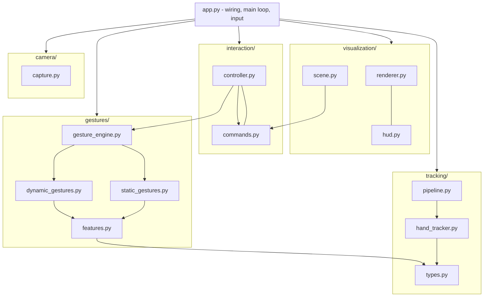
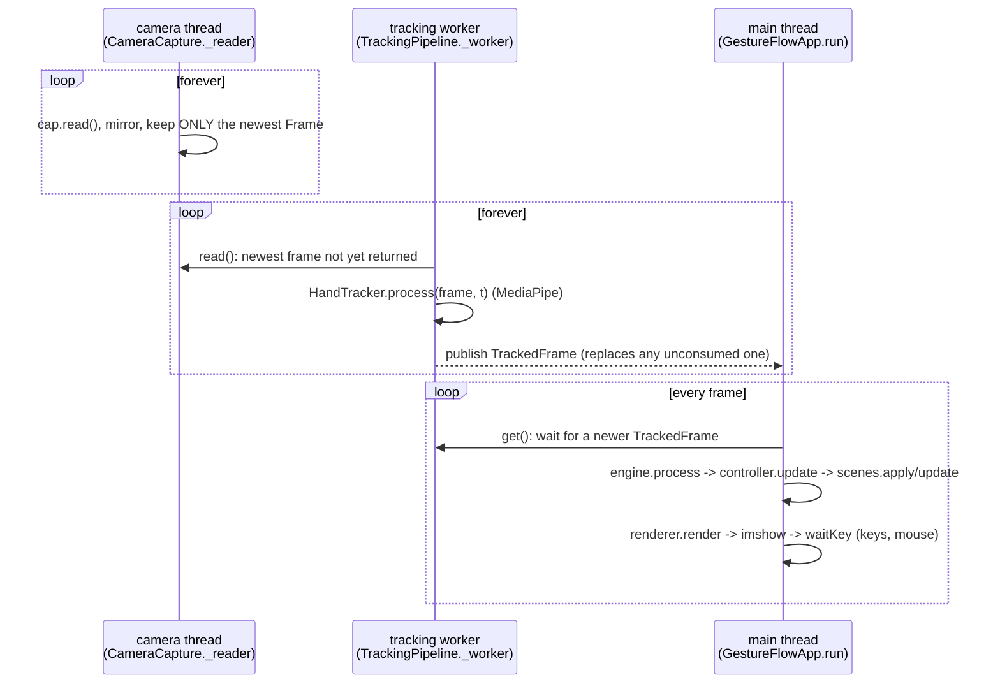

# Architecture

## 1. Layers and the rules between them



Dependencies point **downwards only**; there are no cycles. The rules that keep it that way:

1. **`tracking/types.py` and `gestures/features.py` import neither MediaPipe nor OpenCV.** The
   whole gesture stack runs (and is tested) with NumPy alone. MediaPipe is imported lazily inside
   `HandTracker.__init__`.
2. **Computer-vision code never imports rendering code**, and rendering code never imports the
   gesture engine - it only reads `GestureState` / `InteractionState` values it is handed.
3. **The scene knows nothing about gestures.** It understands only `Command` objects
   (`interaction/commands.py`). The controller knows nothing about drawing.
4. **The renderer only reads state.** Its own animation state (swipe chevrons, the rotation arc)
   is presentation-only and never feeds back.
5. **No module-level mutable state.** Config is frozen dataclasses passed through constructors;
   the few caches (`lru_cache` for font masks / icon masks) are pure.
6. **Time is an argument** (`process(obs, t)`, `update(g, t)`), not a call to `time.time()`.

## 2. Data model

| Type | Defined in | Contents |
|---|---|---|
| `Frame` | `camera/capture.py` | BGR image (already mirrored), monotonic timestamp, frame index |
| `HandObservation` | `tracking/types.py` | `landmarks` (21x3, image-normalised), `world` (21x3, metres), `handedness`, `score`, `timestamp`, `aspect`; property `image_iso` |
| `TrackingResult` | `tracking/types.py` | all `hands`, the `primary` hand, `inference_ms`, `brightness`, `low_light` |
| `TrackedFrame` | `tracking/pipeline.py` | a `Frame` paired with *its* `TrackingResult` and the tracking time |
| `HandFeatures` | `gestures/features.py` | palm-frame points, joint angles, finger extension, pinch distance, spread, palm normal/facing/yaw/pitch, roll, palm centre, palm size, anchor points (index tip, pinch point, two-finger tip) |
| `MotionState` | `gestures/types.py` | palm velocity & speed, roll / roll delta / roll rate, spread / spread delta / spread rate, scroll delta |
| `GestureState` | `gestures/types.py` | per-frame engine output: `gesture`, `confidence`, `static`, `dynamic`, `hold_s`, one-shot `events`, `motion`, `features`, debug `scores`, `stale`, `enabled` |
| `Command` | `interaction/commands.py` | `type`, `object_id`, `position`, `velocity`, `value`, `label` |
| `InteractionState` | `interaction/controller.py` | snapshot for the UI: `active`, `phase`, cursor, pinch point, hovered/selected/grabbed ids, dwell / fist / reset progress, latest command text |
| `Layout` | `visualization/hud.py` | window size -> top bar, side panel, canvas rectangles and UI scale |

Everything that crosses a module boundary is a frozen dataclass or a NumPy array that is not
mutated by the receiver. (`Mesh` arrays are additionally `writeable=False`.)

### Gesture vocabulary

`Gesture` (`gestures/types.py`) is one enum for static and dynamic gestures:

| Static (one frame) | Dynamic (several frames) |
|---|---|
| `OPEN_PALM`, `POINT`, `PINCH`, `FIST`, `TWO_FINGERS` | `PINCH_DRAG`, `PINCH_ROTATE`, `SWIPE_LEFT`, `SWIPE_RIGHT`, `ZOOM_IN`, `ZOOM_OUT` |

`NONE` is the absence of a confident gesture. `GestureState.enabled` carries the set the user has
switched on; the engine zeroes disabled static scores and drops disabled dynamic labels.

## 3. Runtime: threads and the frame loop

Three threads, one hand-off each:



* **Latest-frame semantics, twice.** The camera thread keeps only the newest frame; the tracking
  worker publishes only its newest result. A consumer that is slower than its producer therefore
  skips frames instead of falling behind: latency stays bounded and a stall never builds a backlog.
* **A frame and its result travel together** (`TrackedFrame`), so the skeleton drawn over a video
  frame always belongs to that frame, even though inference overlaps rendering.
* **Throughput** is `1 / max(track, render + logic)` rather than their sum. MediaPipe and OpenCV
  release the GIL during native work, so the overlap is real.
* `TrackingPipeline(threaded=False)` runs the same code inline. Headless simulation uses it so
  runs are deterministic.
* **MediaPipe timestamps** must be strictly increasing integers (ms): `ts = max(int(t*1000), last+1)`.
* `HandTracker.set_max_hands()` re-creates the landmarker under a lock, so the `M` key can switch
  one/two-hand tracking while the worker is running.

### Timing and determinism

`Frame.timestamp` is `time.perf_counter()` at capture. `SimulatedCamera(realtime=False)` instead
issues `index / fps`, so a simulated run with a fixed seed produces identical gesture states on any
machine. `scenes.update(dt)` receives the *frame* delta (clamped to 0.1 s inside the scene so a stall
cannot make objects jump).

## 4. Coordinate systems

Five systems are in play; mixing them up is the most common source of bugs here.

| System | Units | Where | Used for |
|---|---|---|---|
| **Camera-normalised** | x, y in [0,1] of the mirrored frame, y down; z ~ x scale | `HandObservation.landmarks` | where the hand is in the image |
| **Isotropic image** | camera-normalised x and z multiplied by `aspect` -> units of frame height | `HandObservation.image_iso` | angles/distances in the image plane (roll, palm size, velocity) |
| **World** | metres, origin near the hand centre, camera-aligned axes (x right, y down, z away) | `HandObservation.world` | hand *shape*: joint angles, extension, pinch distance, palm normal |
| **Palm frame** | palm lengths; `y` wrist->middle knuckle, `x` index->pinky knuckle, `z` out of the palm | `HandFeatures.norm_points` | rotation/scale-invariant shape (and the learned model's input) |
| **View / scene** | x, y in [0,1] of the *canvas*; scene distances multiply x by the canvas `aspect` | controller, scene, renderer | cursor, object positions, drawing |

Shape comes from world landmarks because they do not change with distance to the camera; position
and motion come from image landmarks because that is what the user sees.

### Camera -> view mapping (`interaction/mapping.py`)

The canvas is not the camera's 4:3, and the hand is hard to track at the very edge of the frame,
so the canvas shows only a **centred active region** of the camera, cropped to *cover*:

```
view = (camera - margin) / (1 - 2*margin)         per axis, margin = (mx, my)
```

`view_margins(view_aspect, camera_aspect, base)` picks the margins so the visible crop has exactly
the canvas aspect ratio (no stretching): the axis with spare room keeps the `base` margin
(`InteractionConfig.active_margin`, default 0.1), the other axis is cropped more. The **same
mapping** is used for the video crop, the skeleton, the cursor and the simulated hand, so the
fingertip, the cursor and the real finger in the video are always at the same place. `camera_to_scene`
additionally clamps to [-0.03, 1.03] so the cursor can rest against an edge. When the window is
resized, `Renderer.layout_version` changes and the app pushes the new margins into the controller
and the new aspect into the scene (`GestureFlowApp._sync_layout`).

## 5. Error handling

| Situation | Behaviour |
|---|---|
| Camera cannot be opened | `CameraError` with the list of working indices and permission hints; `main` prints it with a `--simulate` tip and exits 1 (no traceback) |
| Camera stops mid-run | capture thread re-opens it after `reopen_after_failures` failed reads; meanwhile `pipeline.status == "stalled"` and the UI shows "Camera not responding" and stays responsive |
| Model file missing | downloaded once to `models/` (written to `.part` then renamed, so an interrupted download never leaves a corrupt model); on failure `TrackerError` explains where to put it; exit 2 |
| Tracker raises on the worker thread | stored and re-raised on the main thread as `RuntimeError("hand tracking failed")` with the original as `__cause__`; exit 3 |
| No hand | empty `TrackingResult`; the UI shows "Waiting for hand"; controller releases anything held |
| Hand drops for a few frames | `GestureEngine` keeps the last state for `hand_lost_grace_s`, flagged `stale`, with zeroed motion - a grabbed object is not dropped; longer gaps reset all gesture state |
| Degenerate landmarks (NaN, zero palm) | `extract_features` raises `ValueError`; the engine treats the frame as "no hand" |
| Hand re-appears after a gap (> 0.12 s) | the dynamic recogniser's history is cleared so the position jump cannot register as a swipe |
| Low light | mean luma below `low_light_luma` -> gamma LUT brightens the frame *for detection only* and the UI says so |
| Several hands | `select_primary`: sticky nearest-wrist, else dominant hand, else largest palm |
| Learned model missing / incompatible | `LearnedModelError`; `build_classifier` prints it and falls back to the rule-based classifier |

## 6. Module map

| Path | Responsibility |
|---|---|
| `app.py` | CLI, config assembly, component wiring, main loop, keyboard/mouse, layout sync, graceful exits |
| `config.py` | all tunables ([reference](configuration.md)) |
| `camera/capture.py` | threaded capture, backend choice per OS, reconnect, `FrameSource` protocol |
| `camera/simulated.py` | synthetic backdrop, deterministic timestamps |
| `tracking/hand_tracker.py` | MediaPipe wrapper, model download, low-light LUT, primary selection, per-hand One-Euro filters |
| `tracking/filters.py` | `OneEuroFilter` (vectorised) |
| `tracking/pipeline.py` | worker-thread camera->tracker pipeline |
| `tracking/types.py` | `HandObservation`, `TrackingResult`, landmark constants |
| `tracking/synthetic.py` | parametric hand model |
| `tracking/simulated.py` | scripted demo hand (`GestureScript`, `SimulatedTracker`, `demo_script`) |
| `gestures/features.py` | geometry -> `HandFeatures` |
| `gestures/static_gestures.py` | fuzzy rule-based classifier + `StaticClassifier` protocol |
| `gestures/dynamic_gestures.py` | swipe / zoom / rotate / drag / scroll recognisers |
| `gestures/gesture_engine.py` | EMA, hysteresis, confirm time, dropout grace -> `GestureState` |
| `gestures/learned_classifier.py` | optional scikit-learn classifier + hybrid |
| `gestures/types.py` | `Gesture`, `GestureState`, `MotionState`, UI metadata |
| `interaction/controller.py` | `GestureState` -> `Command`s; interaction state machine |
| `interaction/commands.py` | command vocabulary |
| `interaction/mapping.py` | camera <-> view coordinate mapping |
| `visualization/scene.py` | objects, physics, scene switching |
| `visualization/renderer.py` | layout, base layer, objects, skeleton, feedback |
| `visualization/hud.py` | top bar, readout, side panel, help, debug; `Layout` |
| `visualization/theme.py`, `typeface.py`, `icons.py`, `draw.py` | design tokens, Pillow text, icons, primitives |
| `visualization/shapes.py`, `ui_state.py` | meshes; UI state and gesture families |
| `learning/` | dataset format, recorder, trainer, synthetic data |
| `tools/` | `download_model.py`, `make_screenshots.py`, `gen_config_docs.py` |

## 7. Performance architecture

* **Inference dominates** (10-40 ms on a laptop CPU); everything else in the loop is a few ms.
  Camera resolution barely matters (MediaPipe resizes internally).
* **One hand by default**: with `num_hands=2` MediaPipe runs its palm detector every frame looking
  for a second hand, roughly doubling the cost.
* **Preallocated buffers.** The canvas and the camera scratch buffer are allocated when the layout
  changes; every full-frame OpenCV call writes into them with `dst=`. A freshly allocated
  frame-sized array costs more (page faults) than the arithmetic on it. The viewport, top bar and
  side panel are *views* into one canvas array, so there is no final copy.
* **Cheap blur.** Translucent panels blur their backdrop at quarter resolution.
* **One shadow pass** for all objects instead of one per object.
* **Caches.** The side panel is re-rendered only when something visible in it changes; rasterised
  text and icon masks are cached by `(text, weight, size)` / `(name, size)`.
* **Measure by minimum, not by mean.** On a machine shared with other applications timings swing
  2-3x; the minimum over many runs is the reproducible number. `python app.py --headless
  --max-frames 200` prints a per-stage summary, and `D` shows live timings.
