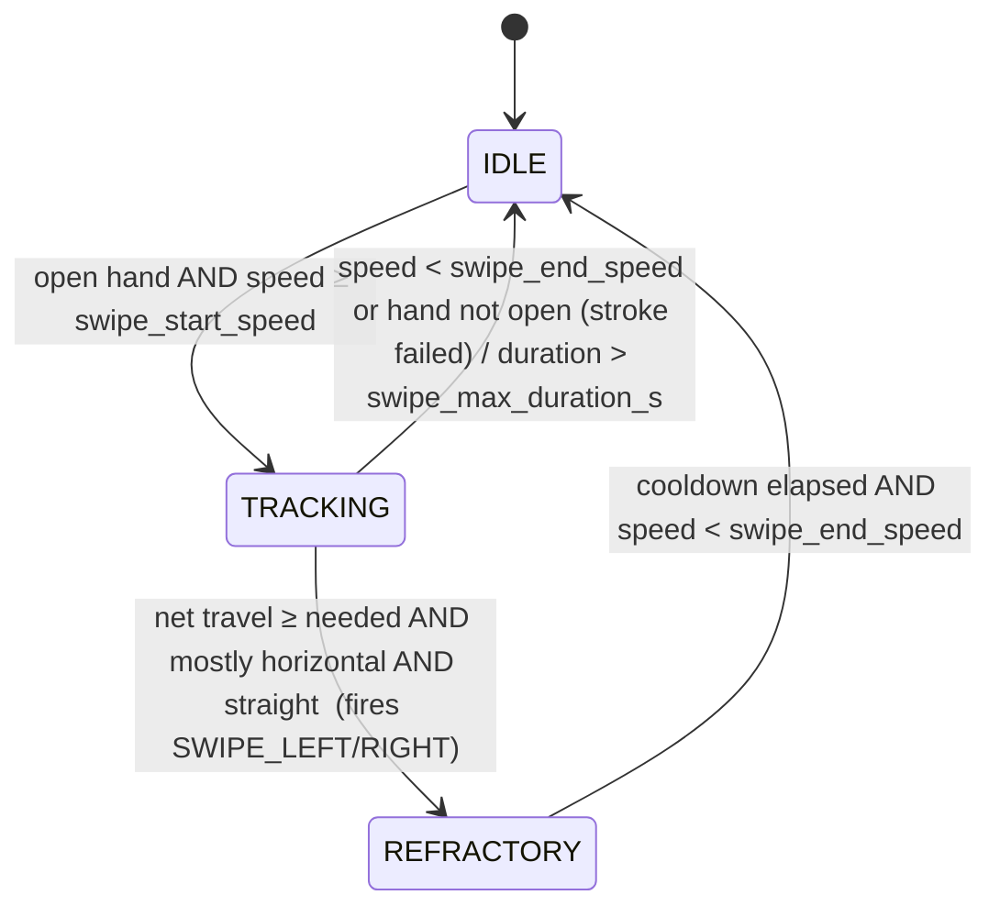

# Gesture recognition

Pipeline for one frame (`gestures/gesture_engine.py`):

```
HandObservation
   │  extract_features()                  gestures/features.py
   ▼
HandFeatures ──► StaticClassifier.classify() ──► raw scores {gesture: 0..1}
   │                                                │ EMA -> hysteresis -> confirm time
   │                                                ▼
   └────────► DynamicGestureRecognizer ◄──── stable static gesture
                       │
                       ▼
                 GestureState
```

All numeric thresholds below are fields of `config.py` ([reference](configuration.md)); names are
given in `code font`.

## 1. Features (`gestures/features.py`)

Shape features use the **world landmarks** (metric, independent of the distance to the camera);
placement and motion features use the **image landmarks**. Every length that reaches a threshold
is divided by the **palm length** `L = ‖p9 - p0‖` (wrist -> middle knuckle). See
[architecture.md](architecture.md#4-coordinate-systems) for the coordinate systems.

### 1.1 Normalisation and the palm frame

```
y = unit(p9 - p0)                         wrist -> middle knuckle ("up the hand")
a = p17 - p5                              index knuckle -> pinky knuckle
x = unit(a - (a·y) y)                     made orthogonal to y
z = s · (x × y),  s = +1 (right) / -1 (left)    palm normal, pointing OUT of the palm
norm_points = ((p - p0) · [x y z]) / L
```

`norm_points` is invariant to translation (wrist at the origin), scale (÷ L) and rotation (palm
frame). The sign `s` makes a left hand a mirrored right hand, so one classifier serves both. A
wrong MediaPipe handedness label would mirror that hand's palm-frame coordinates; the rule-based
classifier does not use them, the learned one would see a mirrored hand.

### 1.2 Joint angles and finger extension

`joint_angle(a, b, c)` is the interior angle at `b`, in degrees (180 = straight). Per finger the
angles are (MCP, PIP, DIP); for the thumb (CMC, MCP, IP).

For index..pinky, with `r(x; lo, hi) = clip((x - lo)/(hi - lo), 0, 1)`:

```
e_mcp   = r(angle_mcp,  mcp_curled_deg,  mcp_straight_deg)
e_pip   = r(angle_pip,  pip_curled_deg,  pip_straight_deg)
e_dip   = r(angle_dip,  dip_curled_deg,  dip_straight_deg)
reach   = ‖tip - wrist‖ / ‖knuckle - wrist‖
e_reach = r(reach, reach_curled, reach_straight)
extension = (w_mcp·e_mcp + w_pip·e_pip + w_dip·e_dip + w_reach·e_reach) / Σw
```

Angles are precise when a finger is seen from the side; the reach ratio stays informative when a
finger points at the camera and the angles become noisy. Blending them is steadier than either.

The thumb folds across the palm instead of curling:

```
extension_thumb = 0.4·r(angle_ip, thumb_ip_curled_deg, thumb_ip_straight_deg)
                + 0.6·r(‖thumb_tip - index_mcp‖/L, thumb_tip_folded, thumb_tip_extended)
```

The thumb is **not used** by the rule-based classifier (only by the learned one and the debug view).

### 1.3 Pinch distance, spread, palm orientation, roll

| Feature | Definition | Typical values |
|---|---|---|
| `pinch_distance` | ‖thumb tip - index tip‖ / L | ~0.25 touching, ~0.9 open hand |
| `spread` (degrees) | mean angle between neighbouring fingers = (φ_pinky - φ_index) / 3, where φ_f = atan2(x, y) of the proximal phalanx (knuckle -> PIP) in the palm frame | ~3-8° fingers together, 15-27° splayed |
| `palm_normal`, `palm_facing` | palm-frame z in camera axes; facing = -normal.z (+1 palm to camera, -1 back of hand) | informational |
| `palm_yaw_deg`, `palm_pitch_deg` | how far the palm normal is turned sideways / up-down | informational |
| `roll_deg` | atan2(vx, -vy) of wrist -> middle knuckle in the image plane; 0 = up, + = clockwise on screen | drives *rotate* |
| `palm_size` | image-plane length of the palm (isotropic units) | normalises velocities |

**Why `spread` is an abduction angle and not a fingertip distance.** Bending a finger at the knuckle
swings its proximal bone towards the palm normal (`z`), not sideways, so `atan2(x, y)` is unchanged by
flexion. Fingertip-to-fingertip distance also changes whenever any finger bends or straightens, which
made relaxing a pinch into an open hand look like a zoom (found in the end-to-end simulation).

### 1.4 Learned-model feature vector

`HandFeatures.to_vector()` has `FEATURE_VECTOR_SIZE = 82` values:

| Slice | Count | Content |
|---|---|---|
| 0-59 | 60 | `norm_points[1:]` (wrist is always the origin) |
| 60-64 | 5 | finger extension (thumb..pinky) |
| 65-79 | 15 | joint angles / 180 |
| 80-81 | 2 | pinch distance, spread / 30 |

## 2. Static classification (`gestures/static_gestures.py`)

Each gesture gets a **soft score** in [0, 1] from fuzzy memberships combined with `min` (fuzzy AND):

```
extended(e) = r(e, extended_lo, extended_hi)         # 1 when the finger is clearly out
curled(e)   = r(e, curled_lo,   curled_hi)           # descending ramp: 1 when clearly curled
pinch_closeness = r(pinch_distance, pinch_open, pinch_closed)     # 1 when the tips touch
index_open      = r(index_extension, pinch_index_min_ext_lo, pinch_index_min_ext_hi)

PINCH       = pinch_closeness · index_open
OPEN_PALM   = min(extended(index), extended(middle), extended(ring), extended(pinky))
POINT       = min(extended(index), curled(middle), curled(ring), curled(pinky))
TWO_FINGERS = min(extended(index), extended(middle), curled(ring), curled(pinky))
FIST        = min(curled(index), curled(middle), curled(ring), curled(pinky))
```

Pinch is the most specific pose, so when it is clearly present it suppresses what a half-closed hand
would also resemble: `POINT *= 1 - 0.8·PINCH`, `FIST *= 1 - 0.6·PINCH`, `OPEN_PALM *= 1 - 0.8·PINCH`.
`index_open` keeps a tight fist (thumb near the index) from being read as a pinch.

A half-closed, ambiguous hand scores around 0.5 for *nothing in particular* instead of flipping a
boolean; the engine's thresholds then leave it as `NONE`. Real-landmark sanity check: MediaPipe's
sample photographs score *point* 1.00 for pointing-up, *two fingers* 0.95 for victory.

`StaticClassifier` is a one-method protocol (`classify(features) -> dict[Gesture, float]`); the
learned classifier and the hybrid implement it too.

## 3. The engine: smoothing, hysteresis, dropouts (`gestures/gesture_engine.py`)

```python
raw      = classifier.classify(features)            # disabled gestures -> 0
scores[g] = α·raw[g] + (1-α)·scores[g]              # EMA, α = score_ema_alpha

challenger = argmax(scores);  incumbent = stable gesture
desired = incumbent
if challenger != incumbent and scores[challenger] >= enter_threshold \
   and (incumbent is NONE or scores[challenger] >= scores[incumbent] + switch_margin):
    desired = challenger
if desired == incumbent and incumbent != NONE and scores[incumbent] < exit_threshold:
    desired = NONE

if desired != incumbent:
    start/continue a pending switch; apply it once desired has persisted for
    confirm_time_s  (pinch_confirm_time_s for PINCH)
```

Three independent mechanisms prevent flicker:

* **EMA** removes single-frame noise.
* **Hysteresis**: enter above `enter_threshold` (0.60) but leave only below the lower
  `exit_threshold` (0.35), so a score hovering around one value cannot toggle.
* **Confirm time + margin**: a challenger must beat the incumbent by `switch_margin` *and* persist.
  The pinch needs a longer confirm time (`pinch_confirm_time_s`, 0.08 s) because the thumb sweeps
  past the index tip while a fist opens or closes; at 0.03 s those transitions grabbed objects.

`confidence` is the smoothed score of the stable gesture (or the dynamic recogniser's confidence).
`GestureState.gesture` prefers a one-shot event, then an active dynamic gesture, then the static one;
anything below `min_confidence` reports `NONE`.

**Dropouts.** When the hand is missing, `_handle_missing` returns the last state with `stale=True`,
zeroed `MotionState` and decaying confidence for up to `hand_lost_grace_s` (so one missed detection
does not drop a grabbed object, and nothing "moves"). After that all gesture state is reset. When
the hand re-appears after a gap longer than 0.12 s, only the dynamic recogniser is reset, so a held
pose survives but the jump cannot create a velocity spike.

## 4. Dynamic gestures (`gestures/dynamic_gestures.py`)

`DynamicGestureRecognizer.update(features, t, static)` keeps ~`history_s` seconds of samples
`(t, palm centre, pinch point, unwrapped roll, smoothed spread, min & mean finger extension)`, all in
isotropic image units. Two normalisations make thresholds distance-independent: positions are divided
by a smoothed `palm_size` (EMA 0.7/0.3) so velocities are in **palm lengths / s**, and roll is
unwrapped across ±180°. The stable static gesture gates which recognisers may run (drag/rotate need a
pinch; swipe and zoom need an open hand).

### 4.1 Swipe (one-shot event)



The stroke is measured from where the hand was ~0.15 s *before* the speed threshold was crossed.
It fires **as soon as** the criteria are met (not when the hand stops), then waits in `REFRACTORY` so
the rest of the same stroke cannot fire again. The criteria:

* `|dx| ≥ swipe_min_distance` palm lengths (×`swipe_return_penalty` if it is the *opposite*
  direction within `swipe_return_window_s` of the last swipe - the hand swinging back is not a swipe),
* `|dx| ≥ swipe_horizontal_ratio · |dy|`,
* straightness `‖net‖ / path length ≥ swipe_min_straightness`,
* the hand is open (mean extension ≥ `swipe_min_open_extension`) and not pinching.

Screen coordinates are already mirrored, so `dx < 0` is `SWIPE_LEFT` as the user sees it.

### 4.2 Zoom (continuous label + per-frame delta)

`rate` is the change of the smoothed `spread` over `zoom_window_s`. Zoom may *enter* only if, for
**every sample in the window**, (a) the weakest finger has extension ≥ `zoom_min_open_extension`,
(b) the mean extension varied by ≤ `zoom_max_extension_drift`, and (c) the hand is not pinching.
Then `|rate| ≥ zoom_enter_rate` -> `ZOOM_IN` (rate > 0) / `ZOOM_OUT`. It stays while
`|rate| ≥ zoom_exit_rate` in the same direction, flips on a strong reverse, and ends
`zoom_hold_s` after the last qualifying motion. (a)+(b) are what stop a fist or pinch relaxing into an
open palm from counting: the fingertips move then, but the finger *shape* is changing. The per-frame
`spread_delta` (degrees) is reported in `MotionState` only while a zoom label is active.

### 4.3 Pinch gestures: rotate and drag

On the rising edge of a stable pinch the recogniser records an anchor (the pinch point) and clears the
rotate/drag state.

* **Rotate**: entering uses `rotate_window_s`: roll rate ≥ `rotate_enter_rate` deg/s, total roll ≥
  `rotate_min_total_deg`, and palm translation ≤ `rotate_max_translation` palm lengths (the hand stays
  roughly in place). *Leaving* uses a much shorter (0.15 s) window: when the roll rate drops below
  `rotate_exit_rate` and `rotate_hold_s` passes, the label ends. (Using the long window for both made
  the label linger ~0.6 s after the twist stopped.)
* **Drag**: pinch point travelled ≥ `drag_deadzone` from the anchor **and** speed over 0.15 s ≥
  `drag_enter_speed`; held while speed ≥ half of that, for `drag_hold_s` after it stops.
* Rotate and drag are mutually exclusive: while rotating, drag is suppressed.

### 4.5 Per-frame measurements

`MotionState` also carries `roll_delta_deg` (wrapped difference to the previous frame; the
controller applies it while the rotate label is active) and `roll_rate`.

### 4.4 Two-finger scroll

While the stable gesture is `TWO_FINGERS`, `scroll_delta` is the vertical travel of the midpoint of
the index and middle tips this frame, in palm lengths (positive = up); zero otherwise. The controller
accumulates it and emits one `CYCLE` per `scroll_step`.

## 5. Optional learned classifier (`gestures/learned_classifier.py`)

`LearnedClassifier` wraps a scikit-learn estimator whose `predict_proba` gives per-label
probabilities; labels that are `Gesture` values become scores, others (e.g. `none`) are simply not
credited. `HybridClassifier` averages rule and learned scores, so a gesture reaches the entry threshold
only when both agree. Everything downstream (EMA, hysteresis, dynamic gestures) is unchanged. Training,
format and latency: [dataset-and-training.md](dataset-and-training.md).

## 6. Calibration status

The geometry was checked against the real MediaPipe landmark layout (sample photographs: pointing,
victory, thumbs up/down, a pair of hands) and against the synthetic hand model, which is built from
approximate anatomical proportions. The **dynamic** thresholds were tuned on synthetic trajectories and
exercised through a real-camera pipeline, but not validated against a population of users. If a
gesture misfires for you, use the debug overlay (`D`) to see finger extensions and scores, adjust the
relevant field in `config.py`, or train the learned classifier on your own recordings.
