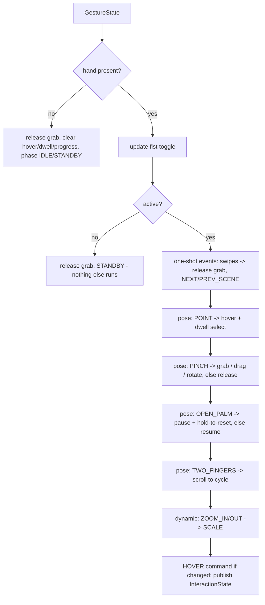

# Interaction and scene

`gestures/` says *what the hand is doing*. `interaction/` decides *what that means*. `visualization/scene.py`
knows *how to carry it out*. The only thing passed between the last two is a small immutable
`Command`.

```
GestureState ──► InteractionController.update(g, t) ──► [Command, ...] ──► SceneManager.apply(cmd)
                          │                                                       │
                          └────────────► InteractionState (for the UI) ◄──────────┘ (reads: pick, positions)
```

## 1. Command vocabulary (`interaction/commands.py`)

| `CommandType` | Fields used | Effect in the scene |
|---|---|---|
| `HOVER` | `object_id` (or `None`) | sets the hovered object (eased highlight level) |
| `SELECT` / `DESELECT` | `object_id` | sets / clears the selection |
| `GRAB` | `object_id`, `position` | object becomes grabbed (and selected); stops any "go home" animation |
| `MOVE` | `position` (view coords) | new spring target of the grabbed object (the zoom is undone to get scene space) |
| `RELEASE` | `velocity` | un-grabs; the object inherits `velocity`, capped at 1.4 scene-units/s |
| `ROTATE` | `object_id`, `value` (radians) | adds to the object's user roll target (eased) |
| `SCALE` | `object_id` or `None`, `value` (factor) | multiplies the object's target scale, or the whole-scene zoom if `None`; clamped to the config limits |
| `CYCLE` | `value` ±1 | select next / previous object, wrapping |
| `NEXT_SCENE` / `PREV_SCENE` | - | `SceneManager.switch` |
| `RESET` | - | objects return to their starting layout and default scale/roll |
| `SET_PAUSED` | `value` 1/0 | ambient time scale -> `paused_time_scale` / 1 |
| `SET_ACTIVE` | `value` 1/0 | engaged / standby (stored on the manager) |
| `GRAB_MISS` | `position` | a pinch closed on empty space (no scene effect; available to UIs) |

`label` is human-readable text for the HUD. The controller never mutates the scene: the application
applies the returned commands (`for c in cmds: scenes.apply(c)`), which is also what the tests do.

## 2. The controller (`interaction/controller.py`)

### 2.1 Inputs, smoothing, and the active region

The cursor (index tip) and the pinch point are mapped camera -> scene with the margin from
`interaction/mapping.py`, then smoothed with their own One-Euro filters (`cursor_min_cutoff`,
`cursor_beta`). If a point jumps more than `max_cursor_step` in one frame (hand re-acquired elsewhere)
the filter restarts instead of sweeping across the screen. `set_margin()` updates the mapping when the
window is resized.

### 2.2 Per-frame decision order



`Phase` (for the UI) is one of `STANDBY, IDLE, POINTING, GRABBED, DRAGGING, ROTATING, ZOOMING, PAUSED,
SWITCHING`.

### 2.3 Behaviours

| Gesture | Logic |
|---|---|
| **Point** | `hover = pick(cursor, pick_slop)`. Dwelling on the same object for `select_dwell_s` emits `SELECT` (once; the scene's `selected_id` is what tells the controller it already happened). Pointing at empty space for 1 s while something is selected emits `DESELECT`. |
| **Pinch, not holding** | `hover = pick(pinch, grab_slop)` previews what would be grabbed. On the *rising edge* only (`_pinch_handled`): nothing under the pinch -> `GRAB_MISS`; otherwise `GRAB`, remembering `offset = object position - pinch point` and resetting the velocity estimate. A second attempt requires re-pinching. |
| **Pinch, holding** | Not rotating: emit `MOVE` to `clip(pinch + offset, 0.02, 0.98)`, so the object keeps the offset it was grabbed at and does not jump. Velocity of the pinch point is an EMA (0.6 old / 0.4 new). Only if `PINCH_DRAG` is enabled. |
| **Rotate** (`PINCH_ROTATE` label active) | emit `ROTATE(roll_delta_deg · rotate_gain)`; **translation is frozen** and the offset is re-anchored every frame, so there is no jump when the twist ends. |
| **Release** (pinch ends, or any non-pinch static gesture) | `RELEASE` with `pinch_velocity · throw_velocity_gain` (zero for swipes / standby / hand loss). |
| **Open palm** | entering emits `SET_PAUSED(1)`, leaving `SET_PAUSED(0)`. A steady palm (speed < `palm_steady_speed`, not zooming) accumulates time; at `palm_reset_hold_s` it emits one `RESET`, then must be withdrawn before it can fire again. Unsteady time decays at twice the rate it accumulates. |
| **Fist** | holding it for `fist_toggle_hold_s` toggles engaged/standby. The hold clock is `min(hold_s, t - (last_pinch_end + fist_after_pinch_lockout_s))`, so closing into a fist to release an object never switches the interface off, and a held fist toggles exactly once. Never counts while an object is held. |
| **Two fingers** | accumulates `scroll_delta`; every `scroll_step` palm lengths up emits `CYCLE(+1)`, down `CYCLE(-1)`. |
| **Zoom** | `SCALE(factor = exp(zoom_gain · spread_delta_deg))` on the grabbed object, else the selected one, else the whole scene. |
| **Swipe** | `SWIPE_LEFT` -> `NEXT_SCENE`, `SWIPE_RIGHT` -> `PREV_SCENE`, after releasing any grab. |

Any gesture whose family the user switched off is simply never reported by the engine; the
controller additionally checks `PINCH_DRAG` / `PINCH_ROTATE` in `GestureState.enabled` because grabbing
and moving are separable.

### 2.4 `SceneQuery`

The controller depends on a four-member protocol, not on the scene class:

```python
selected_id: int | None            # property
pick(x, y, slop=1.4) -> int | None
object_position(object_id) -> tuple[float, float] | None
object_ids() -> list[int]
```

`SceneManager` implements it; the controller tests use a `FakeScene` that applies selection/move
commands, which models the real feedback loop (the app applies commands in the same frame).

## 3. The scene (`visualization/scene.py`)

Pure state and simulation - no drawing, no gesture knowledge, no decorative effects. Positions are
normalised view coordinates; distances multiply x by the view `aspect` (`SceneManager.set_aspect`
keeps it current after a resize).

### 3.1 Objects

A `SceneObject` has an id, a mesh name, layout `home`, `base_radius` (fraction of view height), `depth`
(0 near - 1 far: affects apparent size and brightness only), position/velocity/ambient `drift`, idle
`spin` and `angles`, `scale`/`target_scale`, `user_roll`/`user_roll_target`, and **eased 0-1 levels**
(`select_level`, `hover_level`, `grab_level`, `appear`) so state changes never pop. Apparent size:

```
display_scale = scale · (1 - 0.22·depth) · (0.6 + 0.4·ease_out(appear))
screen_radius = base_radius · display_scale · zoom          (fraction of view height)
```

### 3.2 Per-frame physics (`Scene.update(dt)`, `dt` clamped to 0.1 s)

| What | Rule |
|---|---|
| Ambient time | `sdt = dt · time_scale`; `time_scale` eases (rate 5/s) to 1, or `paused_time_scale` while paused |
| Grabbed object | `pos += (target - pos)·(1 - e^(-24·dt))`; velocity estimated as an EMA (0.65/0.35) of the real displacement, for the throw |
| Free object | `pos += vel·sdt`; `vel` relaxes to its `drift` (rate 1.6/s); soft wall bounce inside `BOUNDS_X/Y` that also flips the drift |
| After `RESET` | for `seek_s = 1.4 s`, `pos += (home - pos)·(1 - e^(-7·dt))`; scale and roll targets return to defaults |
| Scale / roll / zoom | exponential approach with rates 10 / 14 / 9 per second |
| Highlight levels | approach with rates 12 (select) / 14 (hover) / 16 (grab) |
| `pick(x, y, slop)` | the object whose centre is closest within `screen_radius · slop`, using aspect-corrected distance and the *drawn* position (bob and zoom included), so picking always matches what is on screen |

### 3.3 Scenes and transitions

`SceneManager` owns one `Scene` per `ScenePreset` (name, shape list, a near-white tint, background
tone) - layouts are generated deterministically from `DisplayConfig.scene_seed` with rejection
sampling to keep objects apart. `switch(direction)` is ignored during the first half of a running
transition; it releases/hover-clears the old scene, replays the new scene's intro, and starts a
`Transition(previous, direction, progress)` of `transition_s` seconds. The renderer draws both scenes
during it with eased offsets and brightness.

### 3.4 Meshes (`visualization/shapes.py`)

Unit-sphere vertex sets plus edge lists, `writeable=False`: cube (8 verts), tetrahedron (4),
octahedron (6), icosahedron (12), bipyramid (7), torus (84), sphere (60). Regular solids connect
all vertex pairs at the minimal distance, so edges need no hand-written tables.
